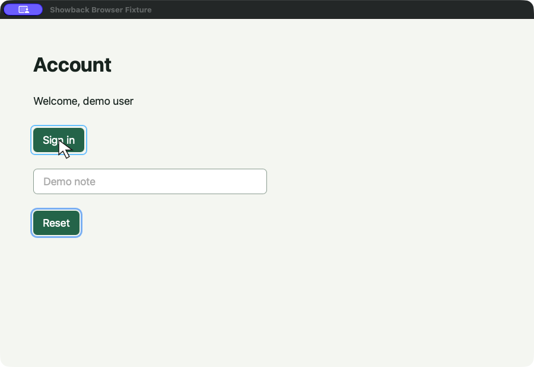

# Showback - make your coding agents show not tell

Showback gives a coding agent hands and a voice on your computer. It controls the real app like a person would — clicks, types, and speaks the walkthrough out loud while it works. It talks to you, explains its output, checks the result on screen, and saves the demo as a shareable MP4.

| Before | With Showback |
|---|---|
| The agent explains in text what it did. You can't trust it, so you have to build it and click through yourself to validate. | Showback goes through your screen, shows the real behavior, and narrates out loud what it did and how it works. |

[](https://github.com/realtonypark/showback/actions/workflows/ci.yml) · [MIT](LICENSE) · macOS · Local speech

[](https://github.com/user-attachments/assets/5bd3110c-95ad-47b9-aaa6-9995a353b397)

**[Watch the demo](https://github.com/user-attachments/assets/5bd3110c-95ad-47b9-aaa6-9995a353b397)** — Showback clicks through a local browser fixture, observes the welcome message, and explains the checked result. [Script](examples/browser-demo.json) · [Reproduce it](examples/README.md#browser-walkthrough)

## Install

Source-first developer preview. Requires **macOS 15+**, Git, and Xcode command-line tools with **Swift 6+**. Apple Silicon on macOS 26.2 is the verified environment; Intel requires AVX2 and remains unverified. There are no signed binary downloads or Homebrew packages yet.

```sh
git clone https://github.com/realtonypark/showback.git
cd showback
./scripts/install.sh
export PATH="$HOME/.local/bin:$PATH"
showback doctor
```

Installation builds the app and downloads about **134 MB** of pinned model, voice, and runtime assets. It commonly takes a few minutes. It installs the CLI, agent skill, and local speech model together:

- `~/Applications/Showback.app`
- `~/.local/bin/showback`
- `~/.agents/skills/showback/`

Add the PATH line to your shell configuration for future terminals. Python and Node are not product dependencies. Source installs are ad hoc signed. Updates use the same installer and restore the previous installation if activation fails. See [installation and troubleshooting](docs/getting-started.md).

## Quickstart

Grant Accessibility and Screen Recording to the launching app when required:

```sh
showback desktop permissions --guide
showback doctor
```

### Ask your coding agent

Tell your favorite coding agent:

> Use Showback to demonstrate this change in the running app. Walk through the changed flow, check the visible result before explaining it, and give me the recorded video.

The skill is installed in the shared `.agents/skills` location. If your host uses another directory, copy [skills/showback](skills/showback) into it:

```sh
mkdir -p /path/to/your/agent/skills
cp -R skills/showback /path/to/your/agent/skills/
```

Pi reads project skills from `.pi/skills`. To use the installed skill from another project, copy it to Pi's user directory:

```sh
mkdir -p "$HOME/.pi/agent/skills"
cp -R "$HOME/.agents/skills/showback" "$HOME/.pi/agent/skills/"
```

Showback runs when requested, not after every code change.

### Try it yourself

Open Showback's Settings:

```sh
open "$HOME/Applications/Showback.app"
```

Once the window appears, run this from the checkout:

```sh
showback validate examples/showback-demo.json
showback run examples/showback-demo.json
```

This example highlights the installed model and voice picker without changing your saved voice. It saves the narrated video under `~/Movies/Showback/`. Use `--mute` to keep narration in the video without playing it through speakers.

The final `Video:` line names `demo.mp4`, with narration and highlights. Use that file for playback or sharing; `recording.mp4` is raw source footage. Failed or cancelled runs label their finalized footage `Partial video:`.

## What you get

- **A live walkthrough:** pointer movement, target highlights, real app interaction, and local narration.
- **Checked outcomes:** fresh accessibility targets and bounded waits for expected UI states. Missing or ambiguous targets stop the demo.
- **A recording bundle:** `demo.mp4`, the original script, `run.json`, a readable result, scene screenshots, source video, and narration audio.
- **Explicit scope:** one window by default. Multi-app demos require an explicitly selected display.

Pocket TTS English 18M provides Alba, Marius, and Javert voices. Runs work offline after installation and use no provider credentials. A checked walkthrough establishes the observed UI states; it does not replace project tests or verify arbitrary narration.

```sh
showback run demo.json --mute
showback run demo.json --live-only
showback run demo.json --out /absolute/path/demo.showback
showback settings
```

Ctrl+C or the Stop control cancels the demo and preserves partial output. A second stop signal forces exit and can leave unfinalized media. Failed and cancelled runs keep that status; existing bundles are not overwritten. Uploading or posting a recording is a separate action.

## Write a demo

```json
{
  "version": 1,
  "title": "Account flow",
  "app": "Example",
  "window": { "title": "Example" },
  "scenes": [
    {
      "say": "I'll open the account page.",
      "actions": [{ "click": { "role": "button", "name": "Sign in" } }],
      "expect": { "text": "Welcome", "timeout": 10 }
    },
    { "say": "The welcome message appeared." }
  ]
}
```

Use your app's actual accessible labels. Put success claims in a scene after the corresponding check. Scripts support point, click, type, select, press, scroll, and wait; they have no shell commands or autonomous recovery.

[Runnable examples](examples/README.md) · [Script contract](docs/scripts.md) · [Agent authoring skill](skills/showback/SKILL.md)

## Contribute

Start with [CONTRIBUTING.md](CONTRIBUTING.md): build commands, test levels, module ownership, and review expectations. Bug fixes, documentation, accessibility reliability, and reproducible examples are useful starting points. Discuss new platforms or major features in an issue before implementing them.

[Report a bug](https://github.com/realtonypark/showback/issues/new?template=bug_report.yml) · [Suggest a feature](https://github.com/realtonypark/showback/issues/new?template=feature_request.yml) · [Report a vulnerability privately](SECURITY.md)

## Project notes

- [Verification evidence and platform coverage](docs/verification.md)
- [Architecture](CONTEXT.md) and [implementation decisions](docs/implementation-decisions.md)
- [Desktop](docs/desktop.md), [speech](docs/speech.md), [recording](docs/recording.md), and [run results](docs/runs.md)
- [Maintainer release checklist](docs/releasing.md)

Inspired by [Scrawl](https://github.com/kitlangton/scrawl): human feedback flows toward the agent; Showback brings the agent's work back as a narrated demonstration.

Showback's own code is [MIT licensed](LICENSE). Downloaded models, voices, runtimes, and the adapted development fixture retain their [separate licenses and attribution](Sources/ShowbackCore/Resources/THIRD-PARTY.md).
